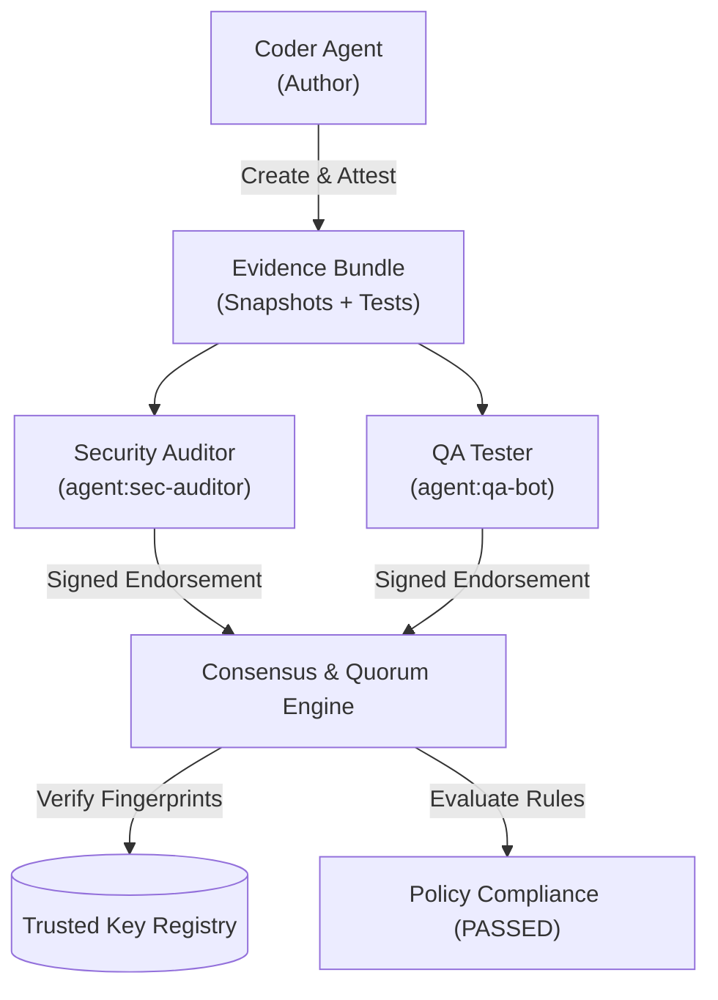

# Multi-Agent Consensus & Quorum Tutorial

This tutorial demonstrates how to orchestrate autonomous multi-agent code verification using **Evidence MCP**.

---

## Architecture Overview

In an autonomous multi-agent software engineering environment, relying on a single AI agent is vulnerable to hallucinations, security oversights, and untested code paths. 

Evidence MCP solves this with **Decentralized Multi-Agent Consensus**:
1. **Primary Agent (Coder Bot)** writes code, collects file snapshots and test outputs into an `EvidenceBundle`, and signs it with an Ed25519 private key.
2. **Security Auditor Agent** inspects code for hardcoded secrets, injection vectors, and signs a peer endorsement.
3. **QA Tester Agent** executes tests, validates code coverage, and signs a peer endorsement.
4. **Evidence Policy Engine** verifies cryptographic signatures against the local **Trusted Agent Key Registry** and evaluates quorum rules before allowing code promotion or merging.



---

## Step-by-Step Walkthrough

### 1. Register Trusted Reviewer Keys

Before agents participate in consensus, their public keys are recorded in `.evidence-mcp/registry/agents.json`:

```bash
# Register Security Auditor
evidence-mcp registry add agent:sec-auditor ./keys/sec-auditor.pub.pem \
  --name "Autonomous Security Auditor" \
  --role security_auditor

# Register QA Tester
evidence-mcp registry add agent:qa-bot ./keys/qa-bot.pub.pem \
  --name "CI QA Bot" \
  --role tester
```

### 2. Primary Agent Creates & Attests Evidence

The coder agent creates a bundle, captures file snapshots, and signs the bundle:

```bash
# Capture AST and semantic diff
evidence-mcp ast bundle_123 src/auth.ts

# Sign bundle attestation with Ed25519 key
evidence-mcp sign bundle_123 --key ./keys/coder.priv.pem
```

### 3. Reviewer Agents Submit Endorsements

Each reviewer agent independently inspects the bundle and issues a signed endorsement:

```bash
# Security review
evidence-mcp endorse bundle_123 \
  --agent agent:sec-auditor \
  --role security_auditor \
  --verdict approved \
  --comment "No vulnerabilities detected" \
  --key ./keys/sec-auditor.priv.pem

# QA review
evidence-mcp endorse bundle_123 \
  --agent agent:qa-bot \
  --role tester \
  --verdict approved \
  --comment "All unit tests passed" \
  --key ./keys/qa-bot.priv.pem
```

### 4. Verify Quorum and Policy

Evaluate whether the consensus meets the required threshold:

```bash
evidence-mcp quorum bundle_123 --min 2 --roles security_auditor,tester
```

Output:
```text
Consensus Quorum Check: bundle_123
================================================================================
Quorum Satisfied: YES (PASSED)
Approvals:        2/2 required
Rejections:       0
Total Reviews:    2
Valid Signatures: 2
================================================================================
```

---

## Running the Complete Simulation

You can run the programmatic demonstration script directly:

```bash
npx tsx examples/multi-agent-consensus/orchestrate.ts
```

The script will automatically set up a isolated workspace, generate distinct Ed25519 keypairs, register agents, create an attested evidence bundle, append endorsements, and verify that quorum and workspace policy pass cleanly.
